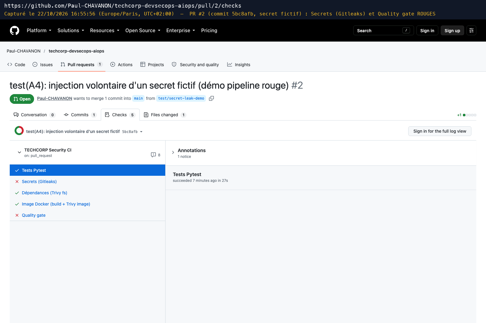
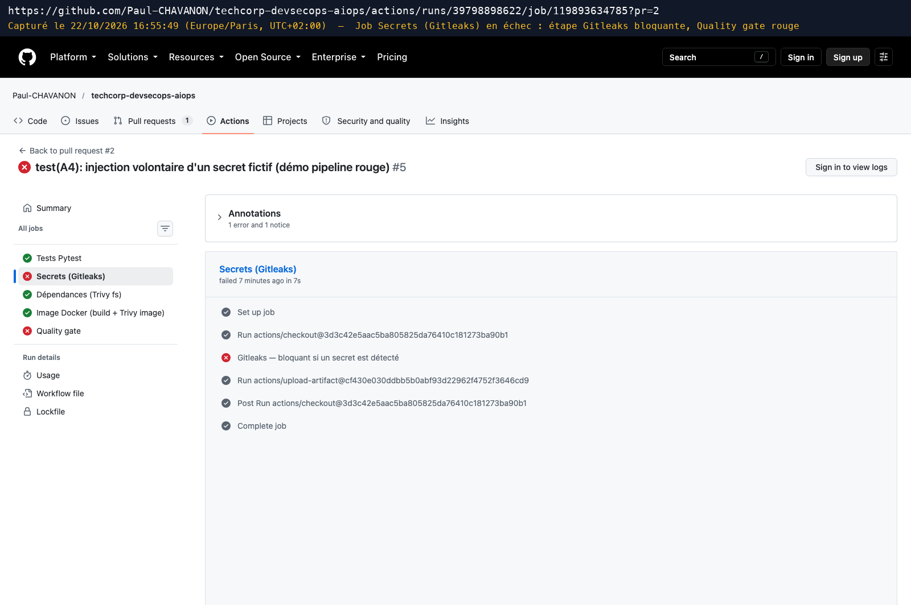
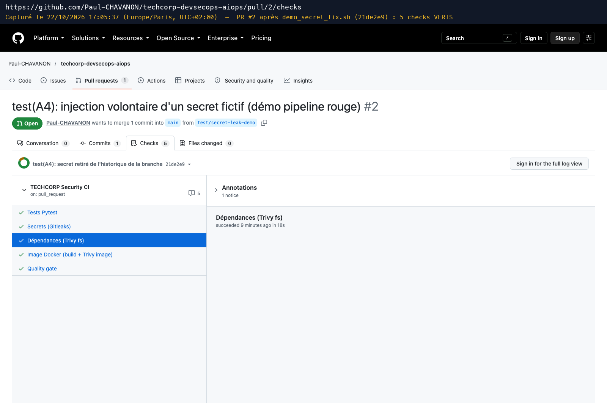
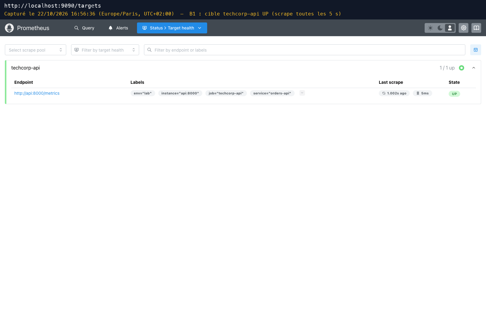
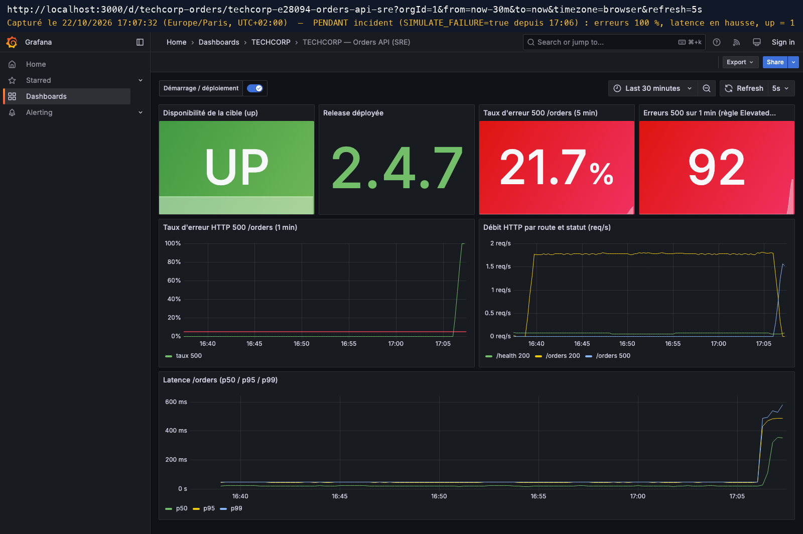
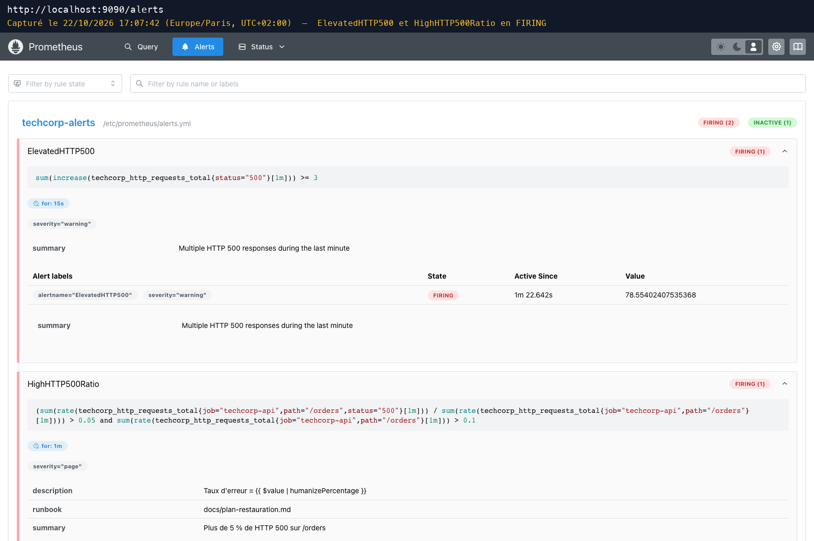
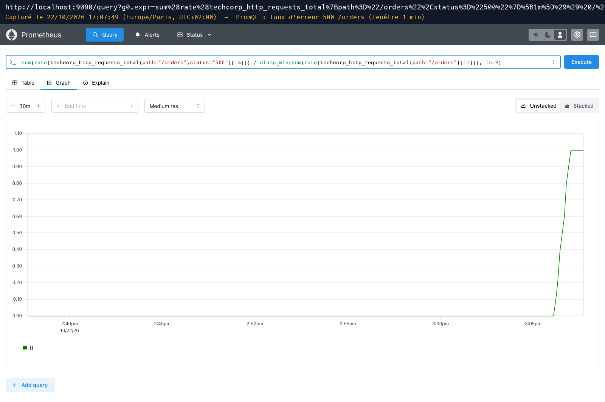
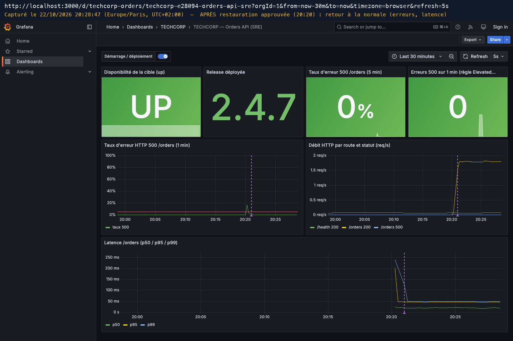

# Rendu — TP TECHCORP DevSecOps & AIOps (INC-2026-1042)

**Équipe :** Paul Chavanon, Nicodem BAJOR · **Rapport PDF :** [TECHCORP_TP_Rendu_Chavanon_Bajor.pdf](TECHCORP_TP_Rendu_Chavanon_Bajor.pdf) · **Dépôt :** https://github.com/Paul-CHAVANON/techcorp-devsecops-aiops · **Exécution :** 22/10/2026, MacBook Apple Silicon (Docker Desktop 29.9.2 arm64, Python 3.12, Ollama `qwen3:14b`)

Toutes les heures sont en heure de Paris (UTC+2), sauf celles des logs et des rapports, qui sont en UTC. Le déroulé complet, avec les problèmes rencontrés et leurs corrections, se trouve dans [journal-execution.md](journal-execution.md). Les captures ont été prises avec [scripts/capture.py](../scripts/capture.py) (Playwright headless, 1600×1000, fr-FR), qui ajoute un bandeau avec l'URL et l'heure.

---

## Mission A — DevSecOps

### A1. Registre des risques

Cinq risques ont été cotés en gravité × probabilité, avec une mesure corrective et le contrôle qui la vérifie : secret dans l'historique, dépendance transitive vulnérable, image non maîtrisée, chaîne d'approvisionnement CI, agent AIOps détourné. Le risque R3 a été confirmé pendant l'exécution : Trivy a trouvé deux HIGH dans le `setuptools` de l'image de base.
→ [registre-risques.md](registre-risques.md)

### A2. Pipeline de sécurité

Le workflow [ci.yml](../.github/workflows/ci.yml) enchaîne Pytest et `promtool`, Gitleaks sur tout l'historique, Trivy `fs` et Trivy `image`, puis le job « Quality gate ». Les actions sont épinglées par SHA, les scanners utilisent des images à version fixe et le `GITHUB_TOKEN` est limité à `contents: read`.

Le premier run sur `main` a été **rouge** (Trivy image : CVE-2026-23949 et CVE-2026-24049 dans le `setuptools` embarqué). La cause a été corrigée sans affaiblir aucun scan : `setuptools==84.0.0`, [PR #1](https://github.com/Paul-CHAVANON/techcorp-devsecops-aiops/pull/1). Le run suivant sur `main` est vert.

### A3. Quality gate

Ce qui bloque : un test en échec, un secret détecté, une vulnérabilité HIGH/CRITICAL avec correctif disponible (dépendances ou image). La politique distingue trois cas : vulnérabilité exploitable (on corrige), faux positif (on corrige la règle de détection) et exception approuvée (entrée justifiée, nommée et datée). `main` est protégée : le check « Quality gate » est obligatoire, une PR est obligatoire, et ces règles s'appliquent aussi aux administrateurs.
→ [quality-gate.md](quality-gate.md), [.gitleaks.toml](../.gitleaks.toml), [.trivyignore](../.trivyignore)

### A4. Pipeline rouge puis vert

[`demo_secret_leak.sh`](../scripts/demo_secret_leak.sh) ajoute un marqueur **fictif** `TECHCORP_FAKE_…` sur une branche de test ([PR #2](https://github.com/Paul-CHAVANON/techcorp-devsecops-aiops/pull/2)) : Gitleaks et le Quality gate passent au rouge. [`demo_secret_fix.sh`](../scripts/demo_secret_fix.sh) réécrit ensuite l'historique de la branche, car un simple `git rm` ne suffit pas, Gitleaks scannant tout l'historique : les 5 checks repassent au vert. La PR a été fermée sans fusion.

*16:55:56 — PR #2, commit `5bc8afb` : « Secrets (Gitleaks) » et « Quality gate » en échec.*

*16:55:49 — Détail du job : l'étape « Gitleaks — bloquant si un secret est détecté » échoue.*

*17:05:37 — Même PR après réécriture de l'historique (commit `21de2e9`) : 5 checks verts.*

Preuves texte : [A4-pr-checks-rouge.txt](../evidence/A4-pr-checks-rouge.txt), [A4-pr-checks-vert.txt](../evidence/A4-pr-checks-vert.txt), [A4-gitleaks-log.txt](../evidence/A4-gitleaks-log.txt) (secret masqué par `--redact`).

### A5. Secrets et permissions

Ce document traite des secrets GitHub Actions, injectés au runtime et masqués dans les logs, et des permissions minimales du `GITHUB_TOKEN`. Il explique aussi pourquoi un Secret Kubernetes, simplement encodé en base64 et lisible par quiconque a accès à etcd ou au RBAC, n'est pas un coffre-fort.
→ [secrets-et-permissions.md](secrets-et-permissions.md)

---

## Mission B — Observabilité et détection

### B1. Cible Prometheus et séries

La cible `techcorp-api` est **UP** (scrape toutes les 5 s). Les requêtes PromQL (200/500 par seconde, taux d'erreur, p95, débit par route) sont documentées dans [observabilite.md](observabilite.md).

*16:56:36 — Prometheus › Target health : `techcorp-api` UP.*

### B2. Tableau de bord Grafana

Le dashboard [techcorp-orders.json](../monitoring/grafana/dashboards/techcorp-orders.json) est provisionné automatiquement. Il montre la disponibilité de la cible, la release, le taux d'erreur sur 5 min et 1 min (seuil 5 %), le nombre de 500 de la règle fournie, le débit par route et statut, et la latence p50/p95/p99.

*16:57:52 — AVANT : trafic nominal d'environ 1,8 req/s, 0 % d'erreur, p95 d'environ 47 ms.*

*17:07:32 — PENDANT : taux d'erreur à 100 % sur 1 min, p95 d'environ 500 ms, alors que `up` reste à 1 : le processus vit, mais le service est inutilisable.*

### B3. Incident de laboratoire

[`simulate_incident.sh 30`](../scripts/simulate_incident.sh) recrée l'API avec `SIMULATE_FAILURE=true`, puis fait 30 appels à `/orders`, tous en HTTP 500. L'incident a été déclenché à 17:06:01, puis rejoué à 17:37:33 pour régénérer un rapport à la chronologie juste (voir C5).

### B4. Règle ElevatedHTTP500 et détection d'anomalies

La règle fournie compte un nombre absolu d'erreurs : 3 erreurs sur 3 requêtes ou sur 30 000 déclenchent la même alerte. La règle `HighHTTP500Ratio` ajoutée raisonne en proportion, avec un trafic minimal. Les deux sont testées par `promtool` en CI. Un seuil répond à « est-ce au-dessus de X ? », alors qu'une détection statistique répond à « est-ce anormal pour ce service ? ».
→ [alerts.yml](../monitoring/alerts.yml), [observabilite.md](observabilite.md)

*17:07:42 — ElevatedHTTP500 et HighHTTP500Ratio en FIRING (actives depuis 15:06:11 UTC).*

*17:07:49 — Graphe PromQL du taux d'erreur 500 sur /orders (axe en UTC) : de 0 à 1.*

Avant l'incident, les 3 règles étaient inactives : [B4-alertes-avant.png](../evidence/B4-alertes-avant.png). Après la restauration : [D-alertes-apres.png](../evidence/D-alertes-apres.png).

### B5. Détecteur

[aiops/detector.py](../aiops/detector.py) calcule le taux d'erreur sur une fenêtre de 5 min. Il le compare à une baseline (moyenne et écart-type des pas précédents) et en tire un z-score et un ratio. Il conclut ANOMALY si le taux dépasse 5 % **et** que le z-score ou le ratio dépasse 3. Chaque étape est écrite dans `reasons`, et le code retour vaut 2 en cas d'anomalie. Il est couvert par 10 tests ([tests/test_detector.py](../tests/test_detector.py)), sur 25 tests au total.

- [B5-detector.txt](../evidence/B5-detector.txt) — 17:08 : **ANOMALY**, taux 33,5 %, baseline 0 %, z = 67, code retour 2.
- [B5-detector-rejeu-baseline-polluee.txt](../evidence/B5-detector-rejeu-baseline-polluee.txt) — 17:38, pendant le rejeu : **OK**, z = −0,22, alors que les alertes étaient en Firing. La baseline contenait le premier incident : c'est la limite du z-score sur une baseline polluée.
- [B5-detector-rejeu.txt](../evidence/B5-detector-rejeu.txt) — 17:42 : **ANOMALY** grâce au ratio (3,07), le z-score n'étant que de 1,33.

---

## Mission C — Investigation AIOps

### C1. Corrélation avec le changement

[aiops/collector.py](../aiops/collector.py) rapproche la première erreur vue dans les logs de l'événement `deploy_success` de la release 2.4.7 : 81 s d'écart. Il présente ce lien comme une **corrélation temporelle, non démonstrative**. Deux défauts découverts pendant l'exécution ont été corrigés et testés : un décalage de 2 h sur les horodatages Docker, et un événement de déploiement perdu par le `--tail` borné ([test_collector.py](../tests/test_collector.py)).

### C2. Collecte minimale, masquage, bornage

Seuls les WARN/ERROR sont gardés. Les e-mails, jetons et DSN sont masqués, et le volume est borné à 500 lignes lues et 40 exemples. Les lignes ressemblant à une injection de prompt sont isolées et ne sont jamais transmises au modèle.
→ [aiops/redact.py](../aiops/redact.py), [C-logs-incident-masques.txt](../evidence/C-logs-incident-masques.txt) (ce que le LLM a reçu), [C-logs-extrait.txt](../evidence/C-logs-extrait.txt) (`docker compose logs --tail 50` après restauration)

### C3. Appel Ollama

L'appel se fait en `POST /api/generate` sur 127.0.0.1 avec `qwen3:14b`, en mode `ollama` réel et sans repli. Deux ajustements ont été faits pour ce modèle à raisonnement : `"think": false`, faute de quoi la réponse était `{}`, et un délai porté à 300 s.
→ [aiops/llm_client.py](../aiops/llm_client.py), [C3-ollama.txt](../evidence/C3-ollama.txt)

### C4. Sortie structurée

Le prompt encadre les preuves comme **données non fiables** et impose un JSON avec : symptômes, hypothèses (confiance, preuves, preuves manquantes), contrôles non destructifs, limites, remédiation. Le code durcit ensuite la sortie : confiance plafonnée, et toute action sensible forcée en approbation humaine.

### C5. Rapports et approbation

[reports/incident-report.md](../reports/incident-report.md) et [reports/report.json](../reports/report.json) portent sur l'incident rejoué à 17:37. L'action « Rollback vers 2.4.6 » a été **APPROUVÉE par Paul Chavanon** (saisie manuelle de `APPROUVE 1`, 20:19:34). [`restore.sh`](../scripts/restore.sh) refuse de s'exécuter sans cette trace, et l'outil n'exécute jamais rien lui-même.

---

## Mission D — Revue SRE

### D21. Pipeline rouge puis vert

Voir A4 : captures horodatées de la PR #2, à 16:55 en rouge et à 17:05 en vert.

### D22. Grafana avant et pendant

Voir B2. Le retour à la normale après la restauration approuvée :

*20:28:47 — APRÈS `restore.sh` (20:20) : 0 % d'erreur sur 5 min, p95 revenu à environ 47 ms. Le pic visible à 20:20 correspond aux dernières secondes de l'incident avant la recréation du conteneur. Entre 18:32 et 20:20, en attendant l'approbation, il n'y avait pas de trafic.*

Détecteur après restauration : **OK**, code retour 0 → [D-detector-apres.txt](../evidence/D-detector-apres.txt).

### D23. Calcul du détecteur

Voir B5 et la section « B5. Calcul du détecteur » de [observabilite.md](observabilite.md). Les trois sorties réelles illustrent le cas nominal, la baseline polluée et le critère du ratio.

### D24. Contester l'IA

Le rapport attribue l'incident à la 2.4.7 avec **75 % de confiance**, sur la seule base d'une coïncidence de 81 s. Aucun diff n'a été examiné, aucune métrique côté base n'est disponible, et un `db_connection_timeout` désigne autant la base ou le réseau que le code. Le modèle affirme aussi qu'un « z-score de 1,44 indique un écart significatif », alors que le seuil est 3. Il propose enfin un rollback conditionnel mal formulé. Le rollback n'a donc été approuvé que comme **mitigation réversible**, et non comme preuve de la cause. En laboratoire, la vraie cause est connue (`SIMULATE_FAILURE=true`).
→ [soutenance.md](soutenance.md)

### D25. Plan de restauration

Le plan couvre les contrôles en lecture seule, le rollback avec critère d'arrêt, la validation, l'observabilité après le changement et le post-mortem.
→ [plan-restauration.md](plan-restauration.md)
